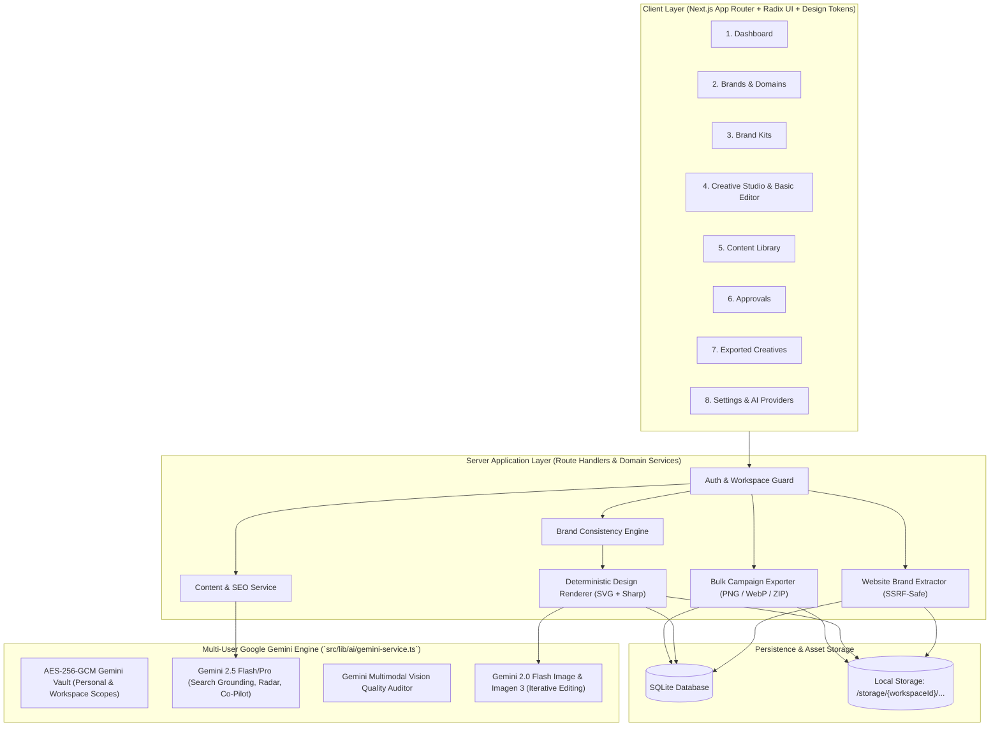

# Social Media Studio — Technical Architecture Specification

**Version:** 1.0 (MVP)  
**Related Document:** [Product Requirements Document (PRD)](./PRD.md)  
**Decision Record:** [2026-11-18-mvp-architecture-and-stack](../.luci/decisions/2026-11-18-mvp-architecture-and-stack.md)

---

## 1. Architectural Overview

Social Media Studio is a multi-tenant, multi-brand creative production SaaS built on a single Next.js (App Router) + TypeScript runtime with SQLite persistence and a deterministic server-side rendering pipeline powered by **Sharp** and structured **SVG/Canvas layout templates**.



---

## 2. Multi-Workspace Isolation & Security Model

### 2.1 Tenant Boundary Enforcement
- Every domain entity (`Brand`, `BrandKit`, `Campaign`, `ContentItem`, `Creative`, `CreativeVersion`, `ApprovalLog`, `ExportJob`, `ProviderConfig`) belongs to a `workspaceId`.
- Server-side repository queries require an authenticated `SessionContext` containing `{ userId, activeWorkspaceId, role }`.
- No database query or filesystem path resolution executes without scoping by `workspaceId`.
- Uploaded brand logos and exported campaign assets are stored outside the public web root under `storage/workspaces/{workspaceId}/...` and served only through authenticated, workspace-verified streaming endpoints (`/api/workspaces/[workspaceId]/assets/[...path]`).

### 2.2 SSRF-Safe Website Brand Extraction
When a user submits a website URL for brand extraction or website-grounded content generation:
1. **Protocol Check**: Only `http:` and `https:` schemes are permitted.
2. **DNS & IP Resolution Check**: Before fetching, the hostname is resolved via `dns.lookup({ all: true })` and checked against blocked CIDR ranges:
   - Loopback (`127.0.0.0/8`, `::1`, `localhost`)
   - Private networks (`10.0.0.0/8`, `172.16.0.0/12`, `192.168.0.0/16`, `fc00::/7`)
   - Link-local & cloud metadata (`169.254.0.0/16`, `fe80::/10`, `100.64.0.0/10`)
3. **Fetch Constraints**: Maximum timeout of `8000ms`, maximum redirect depth of `3` (re-validating each redirect target against the SSRF filter), and maximum response payload size of `2 MB`.
4. **Graceful Manual Fallback**: If a site blocks automated scraping (HTTP 403/429, CAPTCHA, or timeout), the extractor returns a structured partial result with `fallbackRequired: true` so the user can complete or adjust the brand kit manually without losing progress.

### 2.3 Upload Validation
- Logo and custom asset uploads validate both MIME type and magic bytes (`image/png`, `image/jpeg`, `image/webp`, `image/svg+xml`).
- SVG uploads are sanitized to strip `<script>`, `foreignObject`, and inline `on*` event handlers before storage or rendering.

---

## 3. Data Model & Relational Schema (SQLite)

### 3.1 Core Tables

| Table | Primary Key | Key Columns & Relationships |
|---|---|---|
| `users` | `id` (UUID) | `email` (unique), `name`, `password_hash`, `default_workspace_id`, `created_at` |
| `workspaces` | `id` (UUID) | `name`, `slug` (unique), `owner_id`, `settings_json`, `created_at` |
| `workspace_members` | `id` (UUID) | `workspace_id` (FK), `user_id` (FK), `role` (`owner`, `admin`, `editor`, `reviewer`) |
| `brands` | `id` (UUID) | `workspace_id` (FK), `name`, `domain`, `website_url`, `logo_asset_path`, `active_kit_id`, `status`, `created_at` |
| `brand_kits` | `id` (UUID) | `workspace_id` (FK), `brand_id` (FK), `version` (int), `status` (`draft`, `approved`, `archived`), `colors_json`, `typography_json`, `visual_style_json`, `button_style_json`, `extraction_meta_json`, `created_at` |
| `platform_presets` | `id` (UUID) | `workspace_id` (nullable for system presets), `platform` (`instagram`, `facebook`, `linkedin`, `x`, `pinterest`, `tiktok`), `format_name`, `width`, `height`, `safe_margin_px`, `is_active` |
| `campaigns` | `id` (UUID) | `workspace_id` (FK), `brand_id` (FK), `brand_kit_id` (FK), `name`, `objective`, `input_mode` (`manual`, `ai_topic`, `website_grounded`), `topic`, `seo_keywords_json`, `target_audience`, `tone_of_voice`, `status`, `created_at` |
| `content_items` | `id` (UUID) | `workspace_id` (FK), `campaign_id` (FK), `platform` (`shared` or specific platform), `post_title`, `main_text`, `supporting_copy`, `caption`, `hashtags_json`, `cta_text`, `reference_url`, `created_at` |
| `creatives` | `id` (UUID) | `workspace_id` (FK), `campaign_id` (FK), `brand_id` (FK), `brand_kit_id` (FK), `content_item_id` (FK), `platform`, `format_name`, `width`, `height`, `variation_index` (`1`, `2`, `3`), `composition_template` (`editorial_split`, `bold_hero`, `minimal_card`), `approval_status` (`pending`, `approved`, `rejected`), `current_version_id`, `created_at` |
| `creative_versions` | `id` (UUID) | `workspace_id` (FK), `creative_id` (FK), `version_number` (int), `background_asset_path`, `background_prompt`, `layout_overrides_json`, `text_overrides_json`, `rendered_png_path`, `rendered_webp_path`, `created_by`, `created_at` |
| `approval_logs` | `id` (UUID) | `workspace_id` (FK), `creative_id` (FK), `version_id` (FK), `action` (`approved`, `rejected`, `reset`), `actor_id`, `note`, `created_at` |
| `export_jobs` | `id` (UUID) | `workspace_id` (FK), `campaign_id` (FK), `format` (`png`, `webp`, `both`), `zip_asset_path`, `file_count`, `status`, `created_at` |
| `ai_provider_configs` | `id` (UUID) | `workspace_id` (FK), `provider_type` (`image`, `text`), `provider_key` (`huggingface`, `comfyui`, `openai_compat`, `local_procedural`), `endpoint_url`, `model_id`, `is_enabled`, `stats_json` |

### 3.2 Structured Brand Kit Schema (`brand_kits`)
```typescript
export interface BrandColors {
  primary: string;          // Hex e.g. "#0F172A"
  secondary: string[];      // Up to 3 supporting hex colors
  accent: string;           // High-visibility CTA/highlight color
  backgroundLight: string;  // Light surface hex
  backgroundDark: string;   // Dark surface hex
  textOnLight: string;      // WCAG AA verified text color on backgroundLight
  textOnDark: string;       // WCAG AA verified text color on backgroundDark
}

export interface BrandTypography {
  headingFont: string;      // Extracted family name + fallback stack
  bodyFont: string;         // Extracted family name + fallback stack
  weights: {
    regular: number;        // 400
    medium: number;         // 500
    semibold: number;       // 600
    bold: number;           // 700
  };
  scaleRatio: number;       // e.g. 1.25 (Major Third) or 1.333 (Perfect Fourth)
}

export interface BrandVisualStyle {
  characteristic: "minimal" | "modern" | "premium" | "bold" | "corporate" | "editorial";
  borderRadiusPx: number;   // 0, 4, 8, 12, 16, 24
  spacingUnitPx: number;    // 8pt baseline multiplier
  logoPlacementDefault: "top-left" | "top-right" | "bottom-left" | "bottom-right" | "top-center";
  ctaStyle: {
    shape: "sharp" | "rounded" | "pill";
    treatment: "solid" | "outline" | "soft";
    backgroundColor: string;
    textColor: string;
  };
}
```

---

## 4. Module 3: Website Brand Identity Extraction Engine

The extraction pipeline (`src/lib/extractor/website-extractor.ts`) executes in 6 deterministic stages:

1. **Document & Stylesheet Retrieval**: Fetches the target URL HTML (with SSRF guard) and up to 4 linked external `<link rel="stylesheet">` files on the same origin or CDN.
2. **Color Frequency & Role Analysis**:
   - Parses CSS custom properties (`--primary*`, `--brand*`, `--accent*`, `--bg*`), `<meta name="theme-color">`, button rules, header/footer backgrounds, and SVG fill attributes.
   - Normalizes all colors (`rgb()`, `hsl()`, hex) into canonical 6-digit hex and perceptual OKLCH/Lab space.
   - Clusters near-identical shades ($\Delta E < 8$) and ranks recurring brand colors while filtering out generic browser defaults (`#000000`, `#ffffff`, `#ccc`, transparent) from primary/accent slots.
   - Automatically computes WCAG 2.2 AA contrast ratios to assign safe `textOnLight` and `textOnDark` pairings.
3. **Typography Extraction**:
   - Inspects `h1`–`h6` and `body`/`p` CSS rules, `@font-face` declarations, and Google Fonts / Adobe Fonts `<link>` tags.
   - Extracts primary heading font family, body font family, and available weights (`400`, `500`, `600`, `700`).
4. **Button & Visual Pattern Inspection**:
   - Extracts recurring `border-radius` values on `.btn`, `button`, `[role="button"]`, and cards to classify CTA shape (`sharp` = 0–2px, `rounded` = 4–14px, `pill` $\ge$ 16px) and overall design characteristic (`minimal`, `modern`, `premium`, `bold`, `corporate`).
5. **Website Content Summary (for Module 4C)**:
   - Extracts `<title>`, `<meta name="description">`, `og:title`, `og:description`, and primary headings/product copy snippets so website-grounded content generation uses only factual statements from the domain.
6. **Logo Dominant Color Complement**:
   - Uses `Sharp` pixel stats on the uploaded brand logo to cross-verify or enrich the extracted color palette when a website uses minimal CSS or blocks automated crawlers.

---

## 5. Module 6 & 7: Hybrid AI & Deterministic Rendering Engine

### 5.1 Provider-Independent AI Layer (`src/lib/ai/`)
All AI operations implement a strict provider interface with telemetry (latency, success/failure count, estimated cost) and automatic fallback:

```typescript
export interface VisualAssetProvider {
  readonly id: string;
  generateBackground(input: {
    prompt: string;
    width: number;
    height: number;
    brandColors: BrandColors;
    styleCharacteristic: BrandVisualStyle["characteristic"];
    variationIndex: 1 | 2 | 3;
    seed: number;
  }): Promise<{ buffer: Buffer; mimeType: "image/png"; providerUsed: string }>;
}

export interface ContentGenerationProvider {
  readonly id: string;
  generateCampaignCopy(input: {
    brandName: string;
    brandCharacteristic: string;
    mode: "ai_topic" | "website_grounded";
    topic: string;
    objective: string;
    seoKeywords?: string[];
    targetAudience?: string;
    toneOfVoice?: string;
    websiteFacts?: { title: string; description: string; headings: string[] };
  }): Promise<GeneratedCampaignCopy>;
}
```

**Supported Engines & Multi-User Resolution (`src/lib/auth/crypto-vault.ts` & `src/lib/ai/gemini-service.ts`):**
1. **Multi-User Gemini Connection Vault**: Stores AES-256-GCM encrypted API keys per `(scope, userId, workspaceId)` with automatic priority: **Personal User Key (`user`)** -> **Workspace Shared Key (`workspace`)** -> server fallback env. Supports live model/capability probing (`/api/gemini`).
2. **Google Gemini Reasoning & Grounding**: `gemini-2.5-flash` / `gemini-2.5-pro` with Google Search Grounding (`tools: [{ googleSearch: {} }]`), Multimodal Vision Quality Audit, Trend & Brand Radar (`/api/radar`), Conversational Co-Pilot (`/api/copilot`), and Social Tracker Performance Insights (`/api/tracker`).
3. **Google Gemini Image Generation & Iterative Editing**: `gemini-2.0-flash-exp-image-generation` and `imagen-3.0-generate-002`, supporting reference backdrop evolution plus deterministic Sharp brand compositing as an instant fallback.

### 5.2 Deterministic Design Renderer (`src/lib/renderer/creative-compositor.ts`)
AI-generated images are **never** allowed to render text, logos, or CTAs. Instead, `creative-compositor.ts` composites layers deterministically via `Sharp`:

1. **Layer 1 — AI Visual Asset / Backdrop**: Resized and smart-cropped (`sharp.fit.cover`, `position: attention`) to target platform dimensions (`width × height`).
2. **Layer 2 — Brand Consistency Scrim / Split Surface**: Depending on the variation template, places an exact brand-colored structural surface (`backgroundDark`, `backgroundLight`, or `primary` split panel) so text never sits directly on an uncalibrated noisy image.
3. **Layer 3 — Deterministic SVG Typography & Layout Overlay**:
   - Generates a precision SVG at exact target dimensions (`1080×1080`, `1080×1350`, `1200×627`, `1600×900`, `1000×1500`, `1080×1920`).
   - Performs deterministic multi-line text wrapping calculated from character widths, font size, and container safe margins.
   - Renders the exact approved `postTitle`, `supportingCopy`, and `ctaText` inside the brand kit's CTA button shape (`sharp`, `rounded`, `pill`) with guaranteed $\ge 4.5:1$ contrast.
4. **Layer 4 — Brand Logo Placement**:
   - Normalizes and composites the uploaded brand logo at the approved `logoPlacement` (`top-left`, `top-right`, `bottom-left`, `bottom-right`, `top-center`) respecting safe-zone padding and maximum bounding box rules.
5. **Dual-Format Output**: Writes both crisp **PNG** and losslessly/high-quality compressed **WebP** files for every creative version.

### 5.3 Three Distinct Variations per Request
Every generation request produces **3 variations** per selected platform format while preserving identical approved copy and brand tokens:
- **Variation 1 (`editorial_split`)**: Architectural split layout — AI visual scene occupies 55% of the frame; a solid brand surface (`backgroundLight` or `backgroundDark`) houses left-aligned editorial typography, structured accent rule, logo, and primary CTA button.
- **Variation 2 (`bold_hero`)**: High-impact full-bleed AI visual scene with a solid structural brand card container anchored to the lower third, high-contrast display heading, top-aligned brand badge/logo frame, and prominent pill/rounded CTA.
- **Variation 3 (`minimal_card`)**: Studio gallery frame — solid brand primary/secondary perimeter frame enclosing a centered visual asset window, balanced typographic hierarchy, and clean bottom bar with logo and CTA.

---

## 6. Design System Governance & UI Architecture

In compliance with `.luci/local/global-brain.md` and `.luci/rules.md`:
1. **Three-Tier Design Tokens (`src/styles/tokens.css`)**:
   - **Tier 1 (Primitives)**: `--primitive-slate-900`, `--primitive-space-4`, `--primitive-radius-8`, etc.
   - **Tier 2 (Semantic Roles)**: `--color-surface-primary`, `--color-surface-secondary`, `--color-surface-elevated`, `--color-text-primary`, `--color-text-secondary`, `--color-text-muted`, `--color-action-primary-bg`, `--color-action-primary-fg`, `--color-border-subtle`, `--color-status-success`, `--color-status-warning`, `--color-status-danger`.
   - **Tier 3 (Component Tokens)**: `--button-height-md`, `--panel-padding`, `--sidebar-width`, `--focus-ring`.
2. **Zero Hardcoded Values & Anti-Slop Enforcement**:
   - No raw hex values, magic pixel numbers, outer margins (`m-*`) on reusable components, emojis in UI chrome, nested cards, text shadows, gradient header text, or decorative eyebrow pills.
   - Every view presents a single clear primary action identifiable within 3 seconds.
   - All interactive controls meet the `44 × 44 px` minimum target size and expose a `3:1` high-visibility keyboard focus indicator.
3. **10 Primary Navigation Destinations**:
   1. `Dashboard` (`dashboard`)
   2. `Brands & Domains` (`brands`)
   3. `Brand Kits` (`brand-kits`)
   4. `Creative Studio` (`studio`)
   5. `Trend & Brand Radar` (`radar`)
   6. `Social Tracker` (`tracker`)
   7. `Content Library` (`content`)
   8. `Approvals` (`approvals`)
   9. `Exported Creatives` (`exports`)
   10. `Settings & Gemini Vault` (`settings`)
